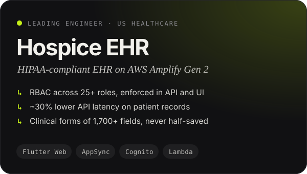
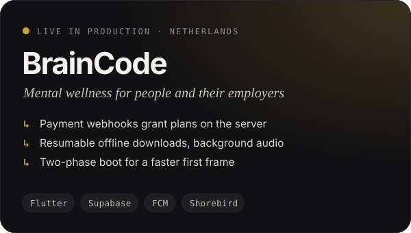
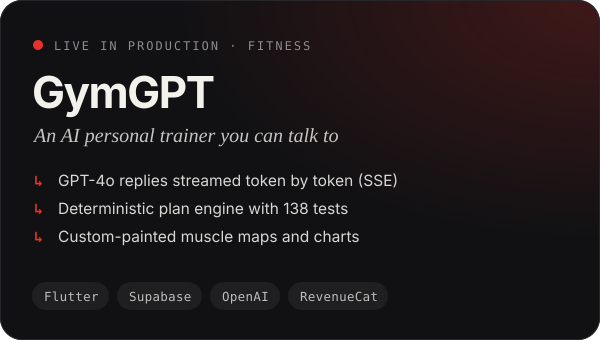
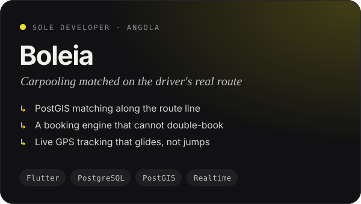
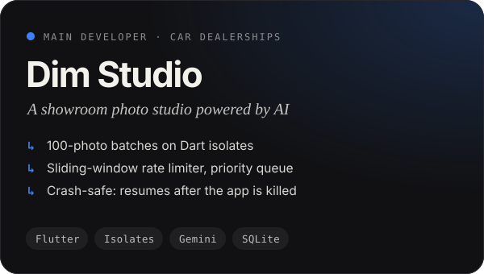
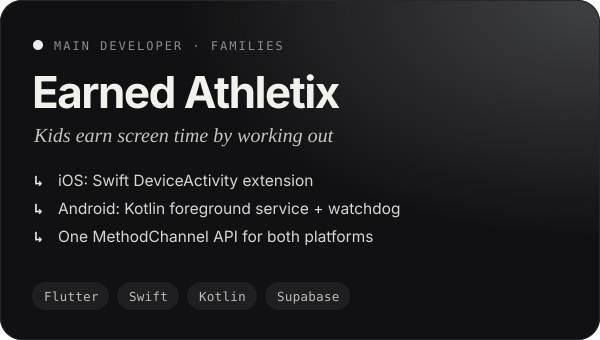

<picture>
  <source media="(prefers-color-scheme: dark)" srcset="./assets/header-dark.svg">
  
</picture>

  &nbsp;
  &nbsp;
  

 

I build software products end to end: **Flutter** apps for iOS, Android and the web, **PostgreSQL** and **AWS** backends, **AI** features, and the release to the App Store and Google Play. I'm the leading engineer on a HIPAA-compliant hospice EHR, and the main engineer on products for clients in the Netherlands, Bahrain, Angola, the USA and France.

Most of that work lives in private client repositories, so the case studies, architecture diagrams and screenshots are on **[taharauf.vercel.app](https://taharauf.vercel.app)**.

 

<picture>
  <source media="(prefers-color-scheme: dark)" srcset="./assets/numbers-dark.svg">
  
</picture>

  

## Selected work

  
  
  
  
  
  

Also: <b>Baytna</b>, a bilingual home-food marketplace on Tap Payments · <b>Cost Captains</b>, AI estimates for contractors on Stripe Connect

 

## Stack

<table>
  <tr>
    <td width="150"><b>MOBILE</b></td>
    <td>
      <picture>
        <source media="(prefers-color-scheme: dark)" srcset="https://skillicons.dev/icons?i=flutter,dart,swift,kotlin,androidstudio&theme=dark">
        
      </picture>
    </td>
  </tr>
  <tr>
    <td><b>BACKEND &amp; CLOUD</b></td>
    <td>
      <picture>
        <source media="(prefers-color-scheme: dark)" srcset="https://skillicons.dev/icons?i=aws,supabase,postgres,graphql,nodejs,ts,firebase,mongodb&theme=dark">
        
      </picture>
    </td>
  </tr>
  <tr>
    <td><b>DELIVERY</b></td>
    <td>
      <picture>
        <source media="(prefers-color-scheme: dark)" srcset="https://skillicons.dev/icons?i=git,githubactions,vercel,figma,vscode&theme=dark">
        
      </picture>
    </td>
  </tr>
  <tr>
    <td><b>ALSO</b></td>
    <td>BLoC / Cubit · GoRouter · AWS Amplify Gen 2 · AppSync · Lambda · Cognito · DynamoDB · PostGIS · Realtime · OpenAI GPT-4o · Gemini · SSE streaming · Stripe Connect · Tap Payments · RevenueCat · Codemagic · Shorebird</td>
  </tr>
</table>

 

## Activity

  <picture>
    <source media="(prefers-color-scheme: dark)" srcset="https://streak-stats.demolab.com?user=Rauftaha757&hide_border=true&disable_animations=true&background=0d1117&ring=c4ee18&fire=c4ee18&currStreakNum=f2f1ec&currStreakLabel=c4ee18&sideNums=f2f1ec&sideLabels=8b8b90&dates=8b8b90&stroke=30363d">
    
  </picture>

  <picture>
    <source media="(prefers-color-scheme: dark)" srcset="https://github-readme-activity-graph.vercel.app/graph?username=Rauftaha757&bg_color=0d1117&color=8b8b90&title_color=f2f1ec&line=c4ee18&point=f2f1ec&area=true&area_color=c4ee18&hide_border=true&custom_title=Contributions%20in%20the%20last%2031%20days">
    
  </picture>

Includes private client work.

 

  <a href="https://taharauf.vercel.app"><b>Portfolio</b></a> &nbsp;·&nbsp;
  <a href="https://taharauf.vercel.app/Taha_Rauf_Software_Engineer_CV.pdf"><b>CV</b></a> &nbsp;·&nbsp;
  <a href="mailto:rauftaha757@gmail.com"><b>rauftaha757@gmail.com</b></a>
   
  Islamabad, Pakistan · open to full-time Flutter, mobile and full-stack roles

